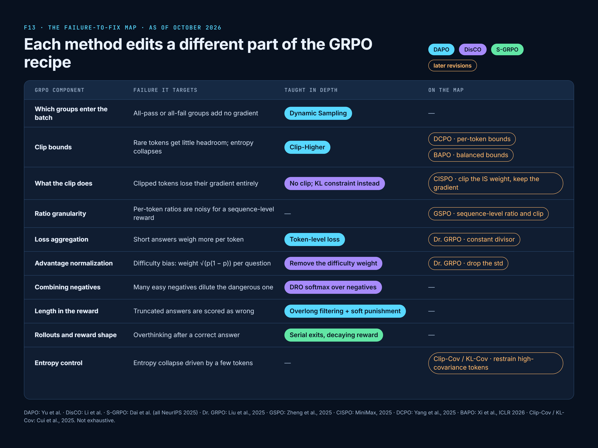

# GRPO, Then and Now: An Interactive Guide to Modern Reasoning RL

**NeurIPS 2026 Education Track** · Samaksh Gulati and Rachel Shalom

[Decks and handouts online](https://samaksh97.github.io/grpo-then-and-now/) ·
[Open the core notebook in Colab](https://colab.research.google.com/github/samaksh97/grpo-then-and-now/blob/main/notebook/01_grpo_core.ipynb) ·
[Source on GitHub](https://github.com/samaksh97/grpo-then-and-now) ·
[Poster (PDF)](poster/grpo_then_and_now_poster.pdf) · code Apache-2.0, content CC BY 4.0

## Overview

This resource teaches how Group Relative Policy Optimization (GRPO) works, where its learning signal
fails, and how DAPO, DisCO and S-GRPO address those limitations. GRPO was introduced in DeepSeekMath and
brought to broad attention by DeepSeek-R1. It is used in the RL stages of DeepSeek-V3 and DeepSeek-R1 and
in Qwen3's reasoning RL, and TRL, verl and OpenRLHF all implement it, so many practitioners start from its
design choices.

Slide decks build intuition first: one claim and one curated figure per slide, with the derivations in
collapsible drawers. CPU-only notebooks then let learners compute each quantity by hand, trigger
controlled failures, test the fixes and complete exercises, using KernelBench-framed examples.



DAPO changes sampling, clipping, aggregation and truncation; DisCO redesigns the objective; S-GRPO targets
overthinking with serial exits. The map also places later revisions of the same components, such as
Dr. GRPO, GSPO, CISPO and adaptive clipping (GRPO deck `slides/grpo_intro.html#response-map`,
`02_failure_lab.ipynb` Appendix D).

## Choose a path

Read the deck, then run the matching notebook. Each deck's last slide points to the next step.

| Time / goal | Slides | Notebooks | What you will learn |
|---|---|---|---|
| 15-minute orientation | [`grpo_intro.html`](slides/grpo_intro.html) | — | GRPO's group baseline, three failure modes, and the map of later fixes |
| **50-minute core path** | [`grpo_intro.html`](slides/grpo_intro.html) | [`01_grpo_core`](notebook/01_grpo_core.ipynb) → [`02_failure_lab`](notebook/02_failure_lab.ipynb) §1–4 → [`03_exercises`](notebook/03_exercises.ipynb) (Exercises 1 and 6) | Compute group-relative advantages, write a GRPO update, break it three ways, and apply DAPO's fixes |
| New to RL: add 20 minutes first | the deck's two refresher slides (`#policy-gradient`, `#ppo-refresher`) | [`00_pg_ppo_refresher`](notebook/00_pg_ppo_refresher.ipynb) | When RL with verifiable rewards beats SFT, policy gradients, baselines, PPO |
| DAPO deep dive | [`dapo_intro.html`](slides/dapo_intro.html) | [`dapo_four_fixes`](notebook/dapo_four_fixes.ipynb) | Clip-Higher, Dynamic Sampling, token-level loss, overlong reward shaping |
| DisCO deep dive | [`disco_intro.html`](slides/disco_intro.html) | [`disco_three_fixes`](notebook/disco_three_fixes.ipynb) | Difficulty bias, non-clipping scores with a KL constraint, hard negatives |
| S-GRPO deep dive | [`sgrpo_intro.html`](slides/sgrpo_intro.html) | [`sgrpo_early_exit`](notebook/sgrpo_early_exit.ipynb) | Serial groups, decaying rewards, learning when to stop reasoning |
| Compare the methods | — | [`04_method_testbed`](notebook/04_method_testbed.ipynb) | GRPO, DAPO, Dr. GRPO, GSPO and CISPO as settings of one objective, run on the same seed, mapped to TRL / verl / OpenRLHF options |

## Run it

**Notebooks.** Every notebook has an *Open in Colab* badge; its first cell fetches this repository when
run outside it. To run locally (Python 3.10+):

```bash
python3 -m venv .venv && .venv/bin/python -m pip install -r requirements.txt jupyterlab
.venv/bin/jupyter lab notebook/
```

| Notebook | Content | Reading time | Runtime |
|---|---|---|---|
| `00_pg_ppo_refresher` | Optional: SFT vs RLVR, the KernelBench running example, policy gradients, baselines, PPO, what GRPO removes | 20 min | 2 s |
| `01_grpo_core` | Group-relative advantages by hand, a 20-line Bandit-GRPO update, the clipped objective on token sequences | 30 min | 3 s |
| `02_failure_lab` | Zero-gradient groups, the upper clip on rare tokens, length-dependent token weights, DAPO's responses; appendices on reward hacking, DisCO, S-GRPO and Dr. GRPO | 40 min | 15 s |
| `03_exercises` | Six exercises; reference solutions in `solutions/exercise_solutions.py` | 15–45 min | 1 s |
| `04_method_testbed` | Every method as a configuration of one objective: presets, a method diff, same-seed runs, and each flag's TRL / verl / OpenRLHF option | 25 min | 6 s |
| `dapo_four_fixes` | Each of DAPO's four techniques with its own experiment | 45 min | 3 s |
| `disco_three_fixes` | DisCO's three fixes and a complete one-question DisCO loop | 45 min | 3 s |
| `sgrpo_early_exit` | S-GRPO's serial group and decaying reward, and a toy exit policy | 20 min | 2 s |

All code cells are short; the toy environments, objectives and plots live in the small NumPy package
[`grpo_lab/`](grpo_lab/), whose docstrings cite the paper equations they implement.

**Slides.** The decks in the release ZIP and on the website are single self-contained files (math library,
shared code and figures embedded), so each opens offline on its own. In this repository they load
`slides/vendor/katex/`, `slides/assets/` and `figures/set/` by relative path. Keys: Space/→ next, ← back,
T light/dark; every slide has a stable link such as `slides/dapo_intro.html#clip-higher`. PDF handouts
(one page per slide, all steps revealed) are in [`slides/handouts/`](slides/handouts/).

## Figures

The curated figure set ([`figures/set/`](figures/set/), alt text and sources in
[`figures.json`](figures/set/figures.json)) is used in both the decks and the notebooks.

| | Figure | | Figure |
|---|---|---|---|
| F1 | One GRPO step | F8 | Overlong reward shaping |
| F2 | PPO-RLHF (four model roles) vs GRPO with RLVR (two) | F9 | Dynamic Sampling over a run |
| F3 | Group-relative advantages | F10 | The clipped objective |
| F4 | Informative groups vs accuracy | F11 | DisCO's hard-negative weighting |
| F5 | Clip headroom | F12 | S-GRPO's serial group |
| F6 | Per-token weight vs response length | F13 | Design-space map |
| F7 | Per-question weight vs difficulty | F14 | Reported results: DAPO ablation; DisCO and S-GRPO |

## What is where

| Path | Purpose |
|---|---|
| [`notebook/`](notebook/) | The eight notebooks, with saved outputs |
| [`grpo_lab/`](grpo_lab/) | Environments, objectives, experiment runners and plots used by the notebooks |
| [`slides/`](slides/) | The four decks, shared deck code (`assets/`), KaTeX (`vendor/`), PDF handouts, and the build scripts |
| [`figures/`](figures/) | The curated figure set and its importer; two refresher diagrams drawn by `generate_primer_diagrams.py` |
| [`solutions/`](solutions/) | Reference solutions for the six exercises |
| [`INSTRUCTOR_NOTES.md`](INSTRUCTOR_NOTES.md) | Session plans, common misconceptions and activities per topic, assessment ideas |
| [`poster/`](poster/) | The NeurIPS poster (61 × 85 cm portrait PDF, plus the PNGs for neurips.cc) and its source; `make poster` rebuilds it |
| [`data/kernelbench/`](data/kernelbench/) | Real KernelBench task metadata with illustrative metrics, provenance and GPU reproduction notes |
| [`tests/`](tests/), [`tools/`](tools/) | Tests (`make test`) and maintenance scripts (notebook runner, figure embedding, site build, browser check) |
| [`concept_summary.pdf`](concept_summary.pdf) | The two-page submission overview |

## For maintainers

```bash
make setup        # .venv with pinned dependencies and test tooling
make test         # unit tests, a headless run of every notebook, deck and link checks
make figures FIGSET="path/to/export.zip"   # import a new figure export and re-embed it in the notebooks
make handouts     # PDF handouts (needs Chrome, Chromium or Edge)
make poster       # the 61 x 85 cm poster PDF and the neurips.cc PNGs (needs Chrome, Chromium or Edge)
make zip          # the submission ZIP (needs an up-to-date concept_summary.pdf)
```

`tools/check_decks_browser.py` opens every deck in Chromium, Firefox and WebKit (Playwright) from
`file://` and from a local server; CI runs it, the tests, and publishes the website
(`.github/workflows/ci.yml`). `tools/publish_github.sh` prepares the public snapshot commit.

## Requirements and prerequisites

NumPy and Matplotlib (pinned in `requirements.txt`); ipywidgets is optional for the slider cells. No GPU,
model weights or API keys. Learners need basic probability and statistics, basic calculus, familiarity with
autoregressive token sampling, and basic reinforcement learning (policies, rewards, policy gradients, PPO);
the refresher covers the last item.

## Limitations

- **Toy mechanisms, not LLM-scale results.** The notebooks isolate each mechanism on CPU
  micro-environments; large-scale effects are cited from the papers, not reproduced. KernelBench task
  specifications are real, but per-kernel metrics are illustrative.
- **Not yet evaluated with learners.** The materials have not been used in a classroom or studied with
  learners. Feedback from instructors and self-learners is welcome.
- **A fast-moving field.** The method coverage reflects work up to October 2026; newer revisions of GRPO
  will need to be added to the map over time.

## License

Code is licensed under Apache-2.0 ([`LICENSE`](LICENSE)); the slides, handouts, figures and the
prose of the notebooks and documentation under CC BY 4.0. Details and attribution:
[`LICENSE-CONTENT.md`](LICENSE-CONTENT.md).

## References

1. [DeepSeekMath](https://arxiv.org/abs/2402.03300) (Shao et al., 2024) — introduces GRPO
2. [DeepSeek-R1](https://arxiv.org/abs/2501.12948) (DeepSeek-AI, 2025) — uses GRPO in large-scale reasoning RL
3. [DeepSeek-V3](https://arxiv.org/abs/2412.19437) (DeepSeek-AI, 2024) — uses GRPO in its RL stage (Sec. 5.2.2)
4. [Qwen3](https://arxiv.org/abs/2505.09388) (Qwen Team, 2025) — uses GRPO for reasoning RL (Sec. 4.2)
5. [DAPO](https://proceedings.neurips.cc/paper_files/paper/2025/hash/a4277440d50f1f15d2cb4c14f7e0c0d2-Abstract-Conference.html) (Yu et al., NeurIPS 2025) — four techniques for stable long-CoT GRPO training
6. [DisCO](https://proceedings.neurips.cc/paper_files/paper/2025/hash/52d6c85793b3dd47636eb430710da915-Abstract-Conference.html) (Li et al., NeurIPS 2025) — discriminative constrained optimization
7. [S-GRPO](https://proceedings.neurips.cc/paper_files/paper/2025/hash/44f09d1973a88529b40029e6c3693ded-Abstract-Conference.html) (Dai et al., NeurIPS 2025) — serial groups with early exit
8. [KernelBench](https://proceedings.mlr.press/v267/ouyang25a.html) (Ouyang et al., ICML 2025) — GPU-kernel generation benchmark
9. [Kevin](https://arxiv.org/abs/2507.11948) (Baronio et al., 2025) — multi-turn GRPO for CUDA kernels
10. [PPO](https://arxiv.org/abs/1707.06347) (Schulman et al., 2017) — the clipped objective GRPO builds on

Later revisions placed on the map (GRPO deck `#response-map`, `02_failure_lab.ipynb` Appendix D):

11. [Dr. GRPO](https://arxiv.org/abs/2503.20783) (Liu et al., 2025) — removes GRPO's length and std normalization
12. [GSPO](https://arxiv.org/abs/2507.18071) (Zheng et al., 2025) — sequence-level importance ratios and clipping
13. [CISPO / MiniMax-M1](https://arxiv.org/abs/2506.13585) (MiniMax, 2025) — clips importance-sampling weights instead of token updates
14. [DCPO](https://arxiv.org/abs/2509.02333) (Yang et al., 2025) — clip bounds adapted to each token's prior probability
15. [BAPO](https://arxiv.org/abs/2510.18927) (Xi et al., ICLR 2026) — adaptive clipping that rebalances positive and negative contributions
16. [Clip-Cov / KL-Cov](https://arxiv.org/abs/2505.22617) (Cui et al., 2025) — entropy control via high-covariance tokens
